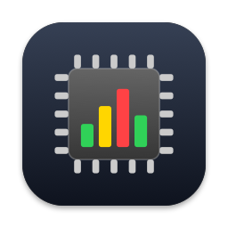
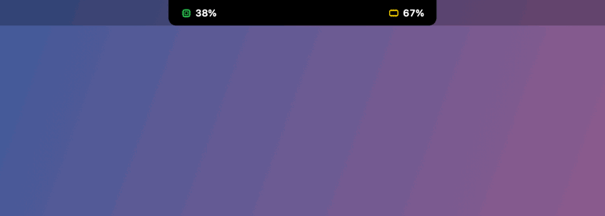
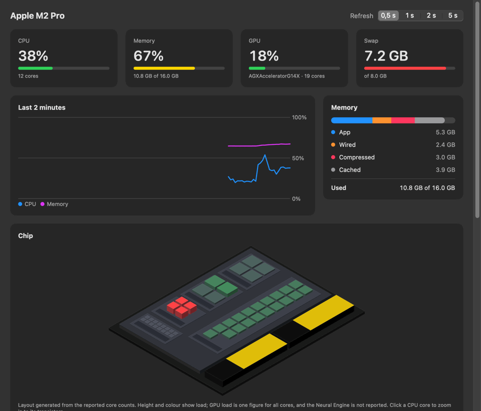
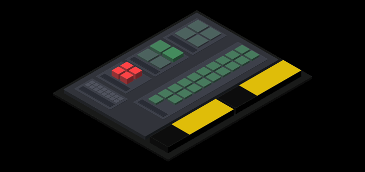
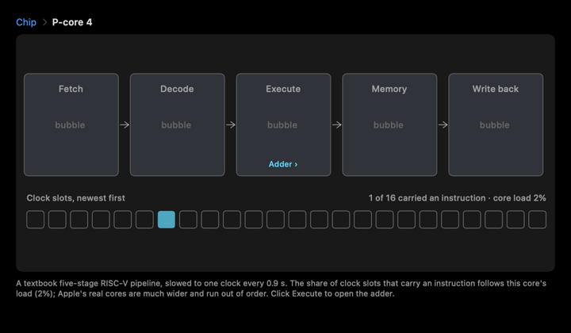
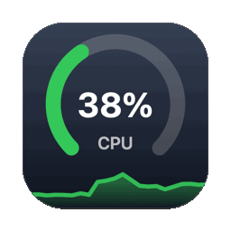

<p align="center">
  
</p>

# Resource Visualizer

[](https://github.com/oorhunn/resource_visualizer/actions/workflows/ci.yml)

A native macOS resource monitor that lives in the notch. CPU and memory sit on either
side of the notch; hover over it to expand a compact panel with a live model of the chip,
memory, GPU, and the busiest processes. A full dashboard window adds history charts, a
memory breakdown, per-core bars, a sortable process table, and a zoom from one CPU core
down to its transistors.

The data layer is a small C++17 backend that reads Mach host statistics, `libproc`,
`sysctl`, and IOKit directly; the app is SwiftUI/AppKit on top of a thin C bridge.
A terminal UI built on the same backend is included as well.

> All the GIFs below are recorded from the app running on live data (an M2 Pro), with half
> the cores busy-looped for a few seconds to show the load changing.

## Build and run

Requires macOS 14+ and the Xcode Command Line Tools (full Xcode is not needed).

```sh
scripts/bundle.sh                 # → build/ResourceVisualizer.app
open build/ResourceVisualizer.app
```

`swift run ResourceVisualizer` also works for quick iteration, without the app bundle.

## Notch



- The wings show average CPU (left) and memory used (right), coloured green below 50%,
  yellow below 80%, red above. The same thresholds are used everywhere in the app.
- Hover the notch to expand it; move away to collapse. The panel shows the chip model,
  CPU, memory and GPU meters, and the four processes using the most CPU.
  **Open Dashboard** brings up the window, **Quit** exits.
- On displays without a notch it appears as a small pill in the middle of the menu bar.
- Toggle it with **Resource Visualizer → Show in Notch** (⇧⌘N). It stays out of the way
  of full-screen apps.

## Dashboard



- **Tiles** for CPU, memory, GPU, and swap, with a selectable refresh rate (0.5–5 s).
- **Last 2 minutes**: CPU and memory history.
- **Memory**: app, wired, compressed, and cached breakdown.
- **Chip**: an isometric model of the processor (see below).
- **Cores**: one bar per core split into user (blue) and system (orange) time, grouped
  into Performance and Efficiency cores on Apple Silicon.
- **Processes**: filter by name or PID; click a column header to sort.

Closing the window keeps the notch running; reopen it from the Dock icon or with ⌘1.

### Chip model



The die layout is generated from the core counts the system reports, so it matches the
machine it runs on: Performance cores, Efficiency cores, the GPU cores, and the memory
packages. Each block rises and changes colour with its own load, and changes are eased
over 0.6 s so the chip moves smoothly between samples instead of jumping. Hover a block
to see its name. GPU load is one figure for all GPU cores, and the Neural Engine is not
reported by macOS.

### Core zoom



Click a CPU core in the chip model to zoom in. Every level is drawn as 3D layout in the
style of [Electric](https://www.staticfreesoft.com/)'s 3D view: each layer is extruded at
its own height in Electric's colours (red polysilicon, blue metal 1, magenta metal 2, gold
metal 3), with metal see-through so the transistors stay visible. Lit channels conduct and
lit metal carries a 1. The zoom opens on the transistors; the breadcrumbs zoom back out:

1. **NAND gate**: one cell of the adder at full size, with p+ diffusion (orange) in the
   n-well and n+ diffusion (green) in the p-substrate, polysilicon gates crossing them,
   contacts, rails and vias, showing which transistors conduct.
2. **Adder**: the low four bits of the adder in the execute stage, with the carry
   rippling from bit 0 to bit 3 for the instruction that just executed. The tiles on each
   full adder are its nine NAND cells; click one to open its transistors.
3. **Pipeline**: a textbook five-stage RISC-V pipeline (fetch, decode, execute, memory,
   write back) as blocks on the die. The share of clock slots that carry an instruction
   follows the real load of that core; idle slots are bubbles. Click Execute for the adder.

Drag to orbit the view and pinch to zoom. Apple does not publish its core design, so this is a
teaching model rather than the real circuit; only the pipeline occupancy is live data.

## Dock



- The app icon is drawn in code (`DockIcon.swift`); `scripts/bundle.sh` exports it to
  `AppIcon.icns`.
- Minimizing the dashboard turns its Dock tile into a live gauge: a ring that eases to the
  current value over a scrolling history sparkline. Choose **CPU** or **GPU** under
  **Resource Visualizer → Minimized Icon Shows**, or from the Dock icon's right-click menu.
  The choice is remembered. The tile only redraws while the window is minimized.
  With **Minimize windows into application icon** turned on in Dock settings, the window has
  no tile of its own, so the app icon shows the gauge until the window is restored.

## Terminal UI

```sh
cmake -S . -B build
cmake --build build -j 4
ctest --test-dir build --output-on-failure
./build/resource-visualizer --interval 0.5 --sort mem
```

| Key   | Action                                      |
|-------|---------------------------------------------|
| `q`   | Quit (Ctrl+C also works)                    |
| `/`   | Filter processes by name or PID (live as you type) |
| `Enter` / `Esc` | Keep the filter / clear it        |
| `c` `m` `p` | Sort processes by CPU, memory (RSS), or PID |
| `+` `-` | Change refresh interval (0.25–10 s)       |

## What the numbers mean

- **CPU** is the average busy time across logical cores; each core is 0–100%.
  Process CPU% counts one full core as 100%, so it can exceed 100%.
- **Memory used** = app + wired + compressed (Activity Monitor's "Memory Used"). Cached
  covers file-backed and purgeable pages the system can reclaim.
- **Process memory** is resident set size; shared pages are counted in every process.
- **GPU** values are optional IOAccelerator driver statistics. On Apple Silicon, GPU
  memory is shared with system RAM.
- Core types come from the IORegistry device tree (`cluster-type`); Intel Macs show a
  single "Cores" group.

## How it works

Every refresh, `Monitor.swift` asks the C++ backend for raw counters on a background
task: per-core CPU ticks, per-process CPU time and resident memory, memory statistics,
and GPU driver statistics. It diffs them against the previous pass to get rates
(wrapping subtraction for the 32-bit tick counters, and process start times to spot
reused PIDs), then publishes the result as `@Observable` state that the notch, the
dashboard, and the Dock tile all read.

## CI and releases

GitHub Actions (`.github/workflows/ci.yml`) runs on every push to `main` and every pull
request:

- **C++ backend and terminal UI**: CMake build with warnings as errors, then `ctest`.
- **macOS app**: debug build, a build with the README recorder enabled, then a release
  `.app` bundle that is checked (binary, icon, `Info.plist`, signature) and uploaded as the
  `ResourceVisualizer` artifact on the run.

Pushing a tag such as `v1.2.0` also publishes a GitHub release with the zipped app,
versioned from the tag:

```sh
git tag v1.2.0 && git push origin v1.2.0
```

The app is ad-hoc signed, not notarized, so macOS blocks it on first launch. Allow it
with **Open Anyway** under **System Settings → Privacy & Security**, or clear the download
quarantine with `xattr -dr com.apple.quarantine ResourceVisualizer.app`.

## Layout

- `src/monitor/` — macOS data collection (`monitor.hpp` is the platform boundary,
  `include/monitor_c.h` + `bridge.cpp` expose it to Swift)
- `app/ResourceVisualizer/` — the SwiftUI app: sampling (`Monitor.swift`), notch panel
  (`Notch.swift`), dashboard window (`DashboardView.swift`), chip model (`ChipView.swift`),
  core zoom (`CoreZoomView.swift`), app icon and Dock tile (`DockIcon.swift`)
- `src/visualizer/` — the terminal UI
- `scripts/bundle.sh` — builds the `.app` bundle
- `scripts/readme-media.sh` — re-records the GIFs in `docs/media/`
- `tests/cpp/` — unit tests for the backend, bridge, and text helpers

## Re-recording the GIFs

```sh
scripts/readme-media.sh
```

This builds the app with a `README_MEDIA` flag that adds an offscreen recorder
(`ReadmeMedia.swift`; it is not compiled into normal builds). The recorder renders each
view in a window placed off screen, drives it with live data for about 25 seconds
(including clicks for the core zoom), busy-loops half the cores for a few seconds, and
writes the GIFs to `docs/media/`. Nothing appears on screen.
